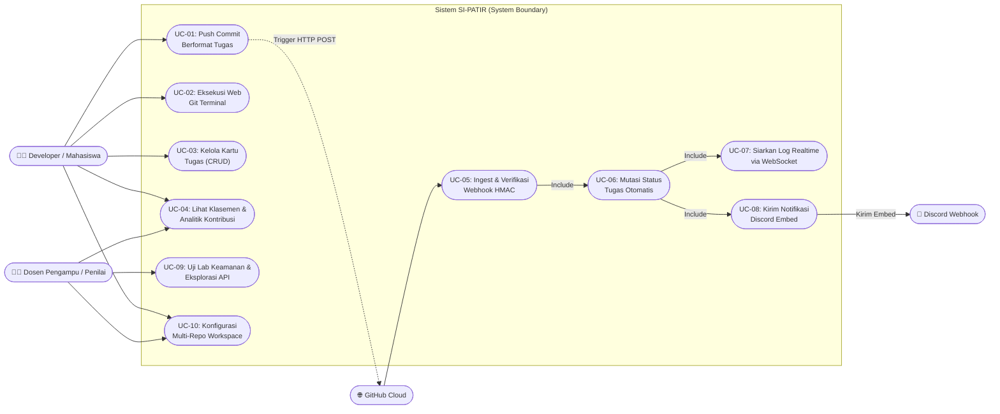
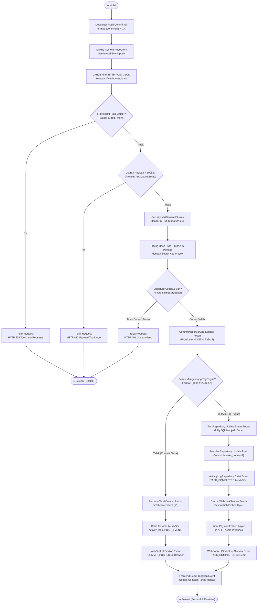
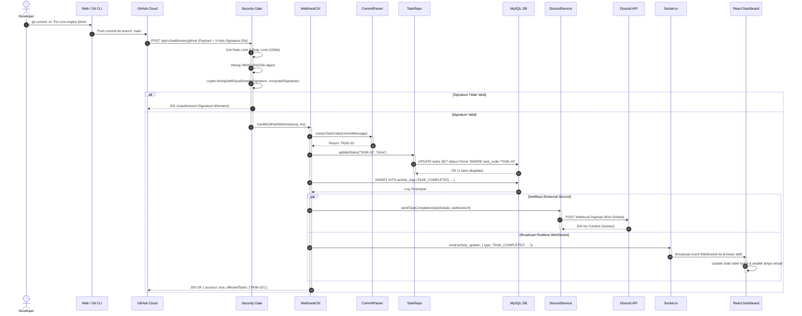
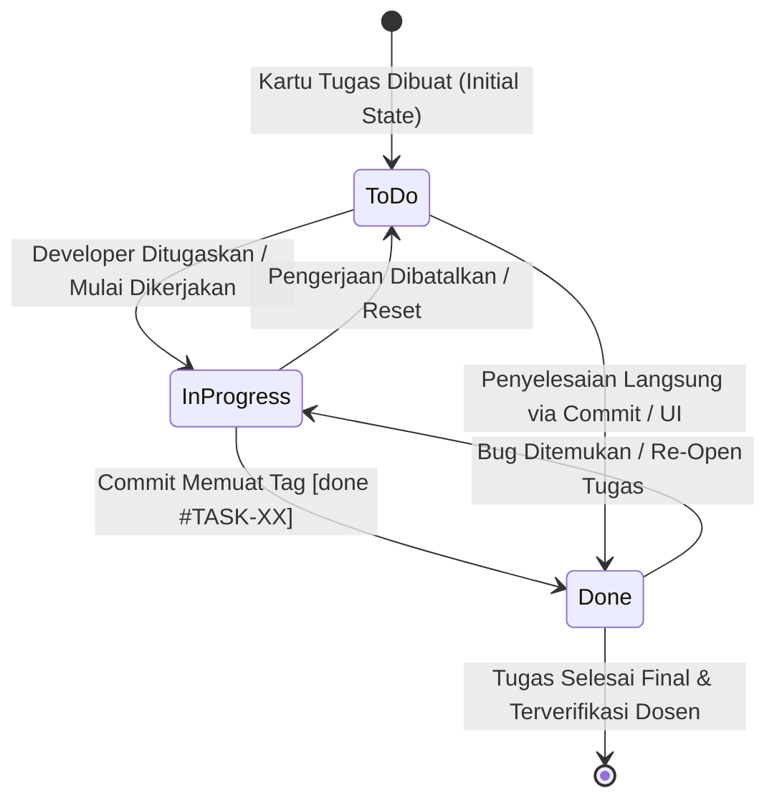
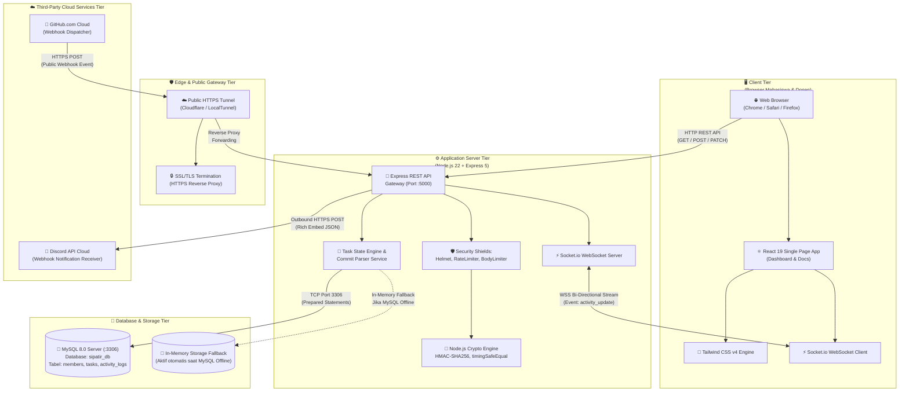

# 📐 Dokumentasi Diagram Arsitektur UML — SI-PATIR
**Sistem Integrasi Pemantau Aktivitas Tugas & Informasi Repositori (DevOps Lite)**
*Mata Kuliah: Pemrograman Integratif*

Dokumen ini memuat kumpulan diagram Unified Modeling Language (UML) formal yang merepresentasikan rancangan arsitektur, interaksi antarkomponen, alur aktivitas proses bisnis, struktur kelas berorientasi objek (OOP), serta arsitektur deployment fisik sistem **SI-PATIR**.

---

## 📑 Daftar Isi Diagram
1. [Use Case Diagram (Diagram Kasus Penggunaan)](#1-use-case-diagram)
2. [Activity Diagram (Diagram Alur Aktivitas Webhook Integrasi)](#2-activity-diagram)
3. [Sequence Diagram (Diagram Sekuensial Event-Driven Webhook)](#3-sequence-diagram)
4. [Class Diagram (Diagram Kelas Arsitektur Backend OOP)](#4-class-diagram)
5. [State Machine Diagram (Diagram Siklus Hidup Status Tugas)](#5-state-machine-diagram)
6. [Deployment & Component Diagram (Diagram Komponen & Penyebaran Fisik)](#6-deployment--component-diagram)

---

## 1. Use Case Diagram
Diagram ini memetakan aktor-aktor yang berinteraksi dengan sistem dan kasus penggunaan (*use case*) yang disediakan oleh platform SI-PATIR.

### Aktor Sistem:
1. **Developer / Mahasiswa**: Mengembangkan kode, melakukan commit, memantau tugas, dan mengeksekusi commit cepat melalui Terminal Web Git.
2. **Dosen Pengampu / Penilai Tugas**: Meninjau dokumentasi teknis, memeriksa integrasi API, melihat metriks kontribusi kelompok, dan menguji simulasi lab keamanan.
3. **GitHub Cloud System (External)**: Memicu notifikasi webhook HTTPS saat terjadi event push repository.
4. **Discord Webhook Server (External)**: Menerima payload bot notifikasi kaya (*Rich Embed*) saat tugas diselesaikan.
5. **Gateway SI-PATIR (Internal Core)**: Memvalidasi keamanan tanda tangan kriptografi, memproses state machine tugas, dan menyiarkan data realtime.

---

## 2. Activity Diagram
Diagram ini menggambarkan alur kerja (*workflow*) end-to-end saat developer melakukan push commit ke repositori Git hingga notifikasi disiarkan ke Discord dan dashboard web.

---

## 3. Sequence Diagram
Diagram sekuensial ini merinci urutan pertukaran pesan antarobjek sistem secara kronologis selama proses eksekusi webhook integrasi.

---

## 4. Class Diagram
Diagram kelas ini memodelkan arsitektur Object-Oriented Programming (OOP) sisi backend platform SI-PATIR (TypeScript / Express).

```mermaid
classDiagram
    %% Core Application
    class Application {
        -app: Express
        -server: HttpServer
        -io: SocketIOServer
        -db: DatabaseService
        +initialize(): Promise~void~
        +start(port: number): void
        -setupMiddlewares(): void
        -setupRoutes(): void
        -setupWebSocket(): void
    }

    %% Database Service
    class DatabaseService {
        -pool: Pool
        -connected: boolean
        -memoryTasks: ITask[]
        -memoryMembers: IMember[]
        +connect(): Promise~void~
        +isConnected(): boolean
        +getPool(): Pool
        +runMigrations(): Promise~void~
        +getMemoryTasks(): ITask[]
        +getMemoryMembers(): IMember[]
    }

    %% Controllers
    class WebhookController {
        -taskRepo: TaskRepository
        -memberRepo: MemberRepository
        -logRepo: ActivityLogRepository
        -projectRepo: ProjectRepository
        -securityService: WebhookSecurityService
        -parserService: CommitParserService
        -discordService: DiscordWebhookService
        -io: SocketIOServer
        +handleGitHubWebhook(req: Request, res: Response): Promise~void~
        +handleSimulate(req: Request, res: Response): Promise~void~
    }

    class TaskController {
        -taskRepo: TaskRepository
        -memberRepo: MemberRepository
        -logRepo: ActivityLogRepository
        +getAllTasks(req: Request, res: Response): Promise~void~
        +getTaskById(req: Request, res: Response): Promise~void~
        +createTask(req: Request, res: Response): Promise~void~
        +updateTaskStatus(req: Request, res: Response): Promise~void~
        +deleteTask(req: Request, res: Response): Promise~void~
    }

    class MemberController {
        -memberRepo: MemberRepository
        -githubService: GitHubIntegrationService
        +getAllMembers(req: Request, res: Response): Promise~void~
        +syncFromGitHub(req: Request, res: Response): Promise~void~
        +clearDummy(req: Request, res: Response): Promise~void~
    }

    %% Domain Repositories
    class TaskRepository {
        -db: DatabaseService
        +findAll(): Promise~ITask[]~
        +findById(id: number): Promise~ITask~
        +findByCode(code: string): Promise~ITask~
        +updateStatus(code: string, status: string): Promise~boolean~
        +upsertTask(task: ITask): Promise~ITask~
        +deleteTask(id: number): Promise~boolean~
    }

    class MemberRepository {
        -db: DatabaseService
        +findAll(): Promise~IMember[]~
        +findByUsername(username: string): Promise~IMember~
        +incrementStats(username: string, isTaskDone: boolean): Promise~void~
        +clearDummyMembers(): Promise~void~
        +recalculateTasksDone(): Promise~void~
    }

    class ActivityLogRepository {
        -db: DatabaseService
        +findRecent(limit: number): Promise~IActivityLog[]~
        +record(event: string, author: string, msg: string, task: string, status: string): Promise~void~
        +clearLogs(): Promise~void~
    }

    %% Services
    class WebhookSecurityService {
        -secretKey: string
        +verifyGitHubSignature(payload: string, headerSig: string, secret?: string): boolean
        +calculateDigest(payload: string, secret: string): string
        +timingSafeBufferCompare(a: Buffer, b: Buffer): boolean
    }

    class CommitParserService {
        +extractTaskCode(message: string): string | null
        +sanitizeCommitMessage(message: string): string
        +isDoneCommit(message: string): boolean
    }

    class DiscordWebhookService {
        -defaultWebhookUrl: string
        +sendTaskCompletion(details: TaskEventDetails, customUrl?: string): Promise~boolean~
        -buildEmbed(details: TaskEventDetails): DiscordEmbedPayload
    }

    %% Relationships
    Application --> DatabaseService : Mengelola Koneksi
    Application --> WebhookController : Mendaftarkan Rute
    Application --> TaskController : Mendaftarkan Rute
    Application --> MemberController : Mendaftarkan Rute

    WebhookController --> TaskRepository : Memanggil Mutasi
    WebhookController --> MemberRepository : Memperbarui Statistik
    WebhookController --> ActivityLogRepository : Mencatat Audit Log
    WebhookController --> WebhookSecurityService : Verifikasi HMAC
    WebhookController --> CommitParserService : Parsing Tag Tugas
    WebhookController --> DiscordWebhookService : Kirim Rich Embed

    TaskController --> TaskRepository : Query & Mutasi Tugas
    MemberController --> MemberRepository : Query & Seeder Anggota
    TaskRepository --> DatabaseService : Eksekusi Query MySQL
    MemberRepository --> DatabaseService : Eksekusi Query MySQL
    ActivityLogRepository --> DatabaseService : Eksekusi Query MySQL
```

---

## 5. State Machine Diagram
Diagram ini memodelkan siklus hidup transisi status kartu tugas (*Task State Machine*) pada tabel `tasks`.

---

## 6. Deployment & Component Diagram
Diagram ini memvisualisasikan arsitektur penyebaran fisik perangkat keras, wadah perangkat lunak (*containers* / *nodes*), serta protokol jaringan penghubung antar-subsistem.

---

## 💡 Poin Kunci Presentasi Tugas Kelompok ke Dosen:
1. **Model Arsitektur Integrasi API**: *Three-Tier Layered Architecture* yang memadukan REST API (komunikasi data web), Webhook API (event-driven dari GitHub & Discord), dan WebSocket (streaming realtime).
2. **Implementasi Keamanan Siber (Security Layer)**:
   - Verifikasi Webhook menggunakan *HMAC SHA-256* dan fungsi konstan waktu (`crypto.timingSafeEqual`) untuk menangkal *timing attack*.
   - Proteksi basis data dari *SQL Injection* menggunakan *Prepared Statements* (parameterized query `mysql2/promise`).
   - Proteksi *Rate Limiting* (30 req/menit untuk webhook) guna mencegah serangan banjir request (*Denial of Service / DoS*).
   - Batas *Payload 100kb* guna menangkal serangan kehabisan memori (*JSON Bomb*).
3. **Kepatuhan OOP & Rekayasa Perangkat Lunak**: Menggunakan pola *Controller-Service-Repository* berorientasi objek dalam TypeScript untuk menjamin pemisahan tanggung jawab kode (*Separation of Concerns*).
4. **Keandalan Sistem (*High Availability*)**: Menerapkan *In-Memory Fallback* otomatis sehingga saat database MySQL lokal mati, backend tidak crash dan notifikasi Discord tetap terkirim normal.
